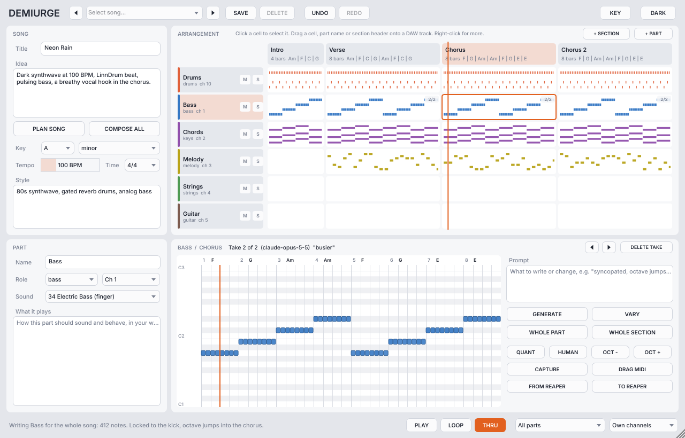

# Demiurge by Bidoo (VST3, CLAP, AU)

Demiurge writes MIDI with Claude, inside your DAW, from the first idea to the arrangement.
You describe a song, it plans the structure (sections, chords, tempo, key, instruments),
writes every part (drums, percussion, bass, keys, pads, strings, brass, woodwinds, choir,
synths, arps, guitars, and a melody line for a singer), plays them in sync with your
transport, and keeps every version so you can try ideas and roll back.

Version 0.1.1. 0.1.1: section directions and voicing instructions (inversions, slash chords).



## How it works

1. **Idea.** Type the song in the SONG panel ("dark synthwave at 100 BPM, LinnDrum, pulsing
   bass, breathy vocal hook in the chorus") and press **PLAN SONG**. Claude returns the title,
   tempo, key, time signature, the arrangement (sections with their chords, one entry per bar)
   and the parts list with what each part should do.
2. **Parts.** Press **COMPOSE ALL** to write every part for the whole song, one part after the
   other so each new part hears the ones before it. Or work cell by cell: select a cell in
   the ARRANGEMENT grid (a part in a section) and press **GENERATE**, **WHOLE PART** (this part in
   every section) or **WHOLE SECTION** (every part in this section).
3. **Tests and rollback.** Every generation is a new *take*: browse them with the arrows next
   to the cell title or the cell's right-click menu, delete the bad ones. **UNDO / REDO** covers
   everything (plans, takes, edits, captures).
4. **Fine tuning.** Write in the cell's **Prompt** and press **VARY** to rework the current take
   ("busier in bar 8", "simpler, leave room for the vocal", "subtle inversions"). The PART
   panel's *What it plays* text is sent every time that part is written. A section has its
   own **direction** (double-click its header): "subtle inversions", "half-time feel",
   "strings only"... applies to every part written in that section. Chords accept slash
   chords (C/E) for exact bass notes. The piano roll edits by hand: double-click to
   add or delete a note, drag to move, drag the right edge to resize. QUANT, HUMAN and OCT -/+
   work on the current take.
5. **Songs** are saved as presets (SAVE in the top bar) and inside your DAW project.

Claude sees the whole song every time: key, tempo, chords, the other parts already written
in the same sections, and the same part in the other sections, so new parts fit and repeated
sections stay recognisable.

## Getting the MIDI into the DAW

A plugin cannot edit the clips on your tracks directly (no plugin format allows it), so
Demiurge gives you four ways, from the most universal to the most integrated:

- **Live MIDI output.** Demiurge plays every part in sync with the host transport, each on its
  own MIDI channel (drums on 10). Route its MIDI output to your instrument tracks. Or put one
  Demiurge per instrument track and choose **Only n Part** in the bottom bar (and a channel if
  your instrument wants one). **LOOP** repeats the selected section. **PLAY** auditions the
  selected section with Demiurge's own clock when the host is stopped (and in the Standalone).
- **Drag and drop.** Drag a cell, a part name, a section header, or the **DRAG MIDI** button onto
  a track: you get a standard MIDI file of that cell, of that part for the whole song, or of
  every part in that section (one track per part). The files are also kept in
  `<app data>/Bidoo/Demiurge/Clips`.
- **Capture (reading a track).** Insert Demiurge on a track that has MIDI, select a part, press
  **CAPTURE**, play the song (or play your keyboard), press **CAPTURE** again. The notes go into
  that part, split over the sections, as new takes Claude can then rework with VARY. Turn
  **THRU** off so the track's own MIDI stops sounding once Demiurge plays its version.
- **Reaper: read and replace MIDI items.** Copy the `reaper` folder's three scripts into
  REAPER's Scripts folder and load the two actions (Actions > Load ReaScript):
  - *Demiurge - Send selected item*: sends the selected MIDI item to Demiurge. Press
    **FROM REAPER** in the plugin to import it into the selected part.
  - *Demiurge - Replace selected item*: after **TO REAPER** (this cell, or this part for the
    whole song), deletes the notes in that range of the selected MIDI item and writes
    Demiurge's, at their song positions, in one undo step. With no item selected, it creates
    one on the selected track.

  Positions are in quarter notes from the project start, which is where Demiurge's song starts.

## Setup

- Press **KEY** and paste your Anthropic API key (console.anthropic.com). It is stored in
  `Settings.xml` in `<app data>/Bidoo/Demiurge` (Windows: `%APPDATA%\Bidoo\Demiurge`,
  macOS: `~/Library/Application Support/Bidoo/Demiurge`). The `ANTHROPIC_API_KEY` environment
  variable works too.
- Model: Opus 5.5 (default, best writing), Sonnet 5.5 (faster, cheaper), Haiku 5.5 (fastest).
  Thinking: Fast / Balanced (default) / Best. Writing a long part for a whole song can take
  a minute or two; the status bar shows what is running and CANCEL stops it.
- The plugin is an FX with audio pass-through that outputs MIDI, like MetroMidi. On macOS
  there is also **Demiurge FX**, an AU MIDI FX for Logic Pro and GarageBand.

### Hosts

- **Reaper:** insert on a track, route the MIDI output (the plugin's I/O button or a send with
  MIDI only) to the instrument tracks. Read/replace items with the scripts above.
- **Bitwig:** use a *Note Receiver* on each instrument track pointing at Demiurge's track.
- **Ableton Live:** Live passes little MIDI from plugins to other tracks, so drag cells and
  parts onto Live's tracks, and use CAPTURE to bring clips back in (play them through
  Demiurge). Not tested in Live yet.
- **Cubase / Studio One:** route the plugin's MIDI output to the instrument tracks.
- **Logic Pro:** one *Demiurge FX* per software instrument track (MIDI FX slot), each set to
  *Only n Part*. Dragging cells to tracks works everywhere.

## Building

CMake 3.22+, a C++20 compiler. JUCE 9.0.3 and clap-juce-extensions are downloaded at
configure time unless `JUCE_DIR` / `CLAP_JUCE_EXTENSIONS_DIR` point at local checkouts.

```
cmake -B out/build/x64-Release -G Ninja -DCMAKE_BUILD_TYPE=Release
cmake --build out/build/x64-Release
```

On Windows the VST3 and CLAP are copied to `C:\Program Files\Common Files\VST3` and `...\CLAP`
after every build (`cmake/KeepPluginsInstalled.cmake`). The `engine_tests` target tests the
song model, the player's timing, the Claude requests and answers, and the Reaper exchange.
`-DDEMIURGE_BUILD_SNAPSHOT=ON` builds `ui_snapshot`, which renders the editor to PNGs.

## Code map

- `src/engine/Song` - the song as a `ValueTree` (sections, parts, cells, takes) with undo.
- `src/engine/Player` - real-time playback against the host position, loop, mute/solo.
- `src/engine/Composer` - the prompts, JSON schemas and answer parsing for the Messages API.
- `src/plugin/AiClient` - HTTPS on a background thread. `Exchange` - MIDI files and Reaper files.
- `src/ui` - the editor in the shared Bidoo look (`BidooLook.h`, identical in every Bidoo repo).
